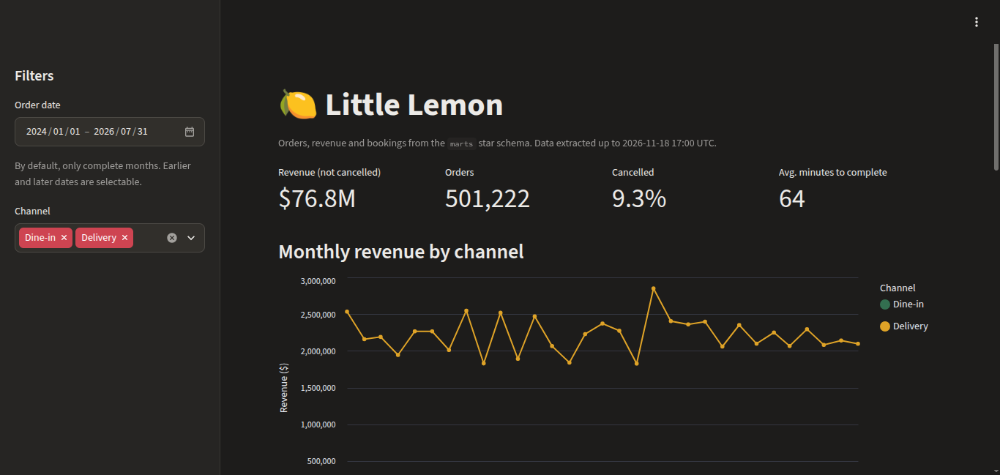
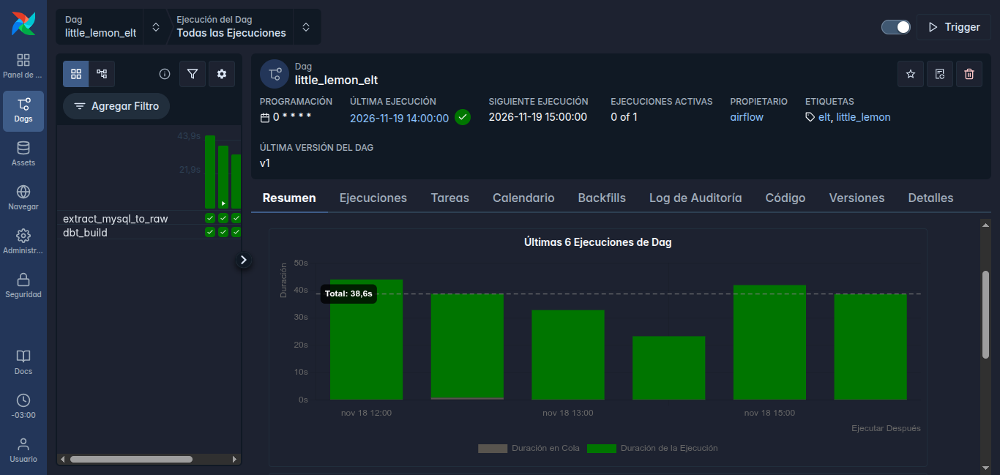
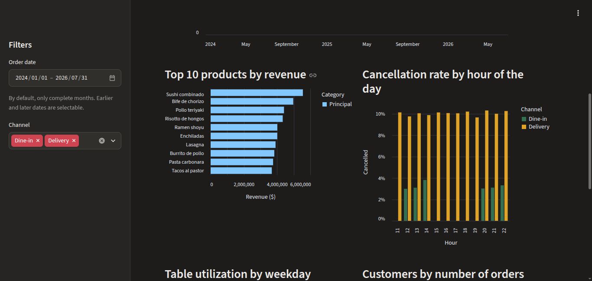
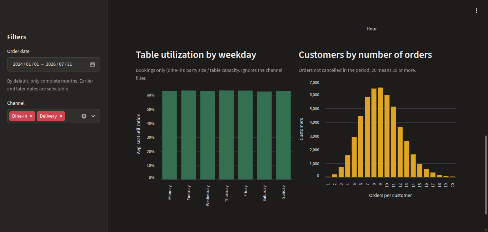

# Little Lemon: from a database capstone to an ELT pipeline

An end-to-end data engineering project built on top of my database
engineering capstone. The **Little Lemon** restaurant runs on a MySQL
operational database; an incremental, idempotent extractor copies it into a
PostgreSQL warehouse, **dbt** models it into a star schema with SCD2
dimensions, **Airflow** runs it every hour, and a **Streamlit** dashboard
answers business questions on top of it. Everything runs locally with Docker
Compose, on 4.4 M reproducible synthetic rows.



## Architecture

```
                         Airflow 3.4 · DAG little_lemon_elt (hourly)
                     ┌──────────────────────────┬──────────────────────────┐
                     ▼                          ▼                          │
MySQL 8.4 (OLTP)   extract_mysql_to_raw.py    dbt build                    │
little_lemon_       incremental by UpdatedAt   staging → intermediate        │
restaurante  ─────▶ advisory lock, atomic ───▶ → marts (star, SCD2) ──▶ Streamlit
4.4 M rows          watermark per table        122 tests                 dashboard
                     │                          │
                     └──────▶ PostgreSQL 18 warehouse: raw · staging · intermediate · marts
```

| Layer | What it holds |
|---|---|
| `raw` | Append-only copy of the 14 MySQL tables: every version the extractor saw |
| `staging` | Latest version of each row, snake_case names, no business logic |
| `intermediate` | SCD2 version ranges and the final status of each order |
| `marts` | Star schema: `fct_orders`, `fct_order_lines`, `fct_reservations` and six dimensions |

```
                    dim_date
                       │
dim_customers ── fct_orders ──── dim_staff, dim_menus
       │               │
       │        fct_order_lines ── dim_menu_products
       │
       └──── fct_reservations ── dim_restaurant_tables
```

**Stack:** MySQL 8.4 · PostgreSQL 18 · Python 3 (mysql-connector, psycopg 3) ·
dbt Core 1.12 · Airflow 3.4 · Streamlit 1.67 · pytest · Docker Compose.

## Engineering highlights

Each decision has a short ADR in [docs/adr/](docs/adr/) with its context and
trade-offs.

- **Incremental extraction that is safe to retry.** Each run reads the rows
  whose `UpdatedAt` falls in `(watermark, now − 30 s]`, and loads them, moves
  the watermark and logs the run in one PostgreSQL transaction. A failure
  leaves nothing half-done, and a PostgreSQL advisory lock stops two runs from
  overlapping. Integration tests prove it by injecting failures mid-load
  ([ADR-004](docs/adr/004-incremental-extraction-to-raw.md)).
- **Cancelling no longer deletes.** The capstone's procedures deleted rows,
  which an incremental extractor can never see. A migration made cancellation
  a status change, so history is kept
  ([ADR-002](docs/adr/002-cancel-by-status-instead-of-delete.md)).
- **SCD2 rebuilt from raw, not from snapshots.** Because `raw` keeps every
  version, customer and product history (prices included) is derived with
  window functions and can be rebuilt at any time. Facts join the version
  valid at the moment of the event
  ([ADR-006](docs/adr/006-star-schema-and-scd2-from-raw.md)).
- **Reproducible volume.** A seeded generator adds 4.4 M rows using only
  `random.random()`, the one function Python guarantees to be stable across
  versions; two runs give identical data (checked with per-table checksums)
  ([ADR-003](docs/adr/003-synthetic-data-generator.md)).
- **Optimizations backed by measurements.** `EXPLAIN ANALYZE` benchmarks drove
  the materialization and indexing choices, and two ideas were rejected
  because the numbers got worse ([docs/performance.md](docs/performance.md),
  [ADR-008](docs/adr/008-materialize-staging-and-index-marts.md)).

## Results

| | |
|---|---|
| Data | 4.4 M rows in MySQL: 50 k customers, 501 k orders, 1.4 M order lines, 2.3 M status events |
| Full extraction | ~40 s; a run without changes, < 1 s |
| `dbt build` | ~40 s: 26 models, 122 tests (data tests, SCD2 integrity, unit tests) |
| Dashboard queries | 25–410 ms; per-customer lookup 0.1 ms |
| Tests | 9 pytest integration tests (idempotency, failures, concurrency) |
| Airflow | ~850 MB of RAM; retries verified with MySQL stopped mid-run |



## Quickstart

**Requirements:** Docker with Compose, Python 3.12+ and about 2 GB of free RAM
with everything running (Airflow alone uses ~850 MB).

```bash
cp .env.example .env          # then set your own users and passwords
docker compose up -d --wait   # MySQL with the capstone data, PostgreSQL warehouse
python3 -m venv .venv
.venv/bin/pip install -r requirements-dev.txt
set -a; source .env; set +a

.venv/bin/python scripts/generate_synthetic_data.py --seed 42 --scale 1.0   # ~3 min, optional
.venv/bin/python scripts/extract_mysql_to_raw.py
.venv/bin/dbt build --project-dir dbt --profiles-dir dbt

docker compose --profile airflow up -d --build --wait     # http://localhost:8080
docker compose --profile dashboard up -d --build --wait   # http://localhost:8501
```

Each step is explained below.

## Step by step

### 1. Source database (MySQL)

The capstone database `little_lemon_restaurante` has 14 tables, triggers that
keep `Orders.Quantity` and `Orders.TotalCost` in sync with `OrderDetails`, and
stored procedures for bookings and orders.

| Domain | Tables |
|---|---|
| Customers & orders | `Customers`, `Orders`, `OrderDetails`, `OrderDeliveryHistory`, `DeliveryStatuses` |
| Bookings | `Reservations`, `RestaurantTables` |
| Menu | `Menus`, `MenuItems`, `MenuProducts`, `MenuCategories`, `Cuisines` |
| Staff | `Staff`, `StaffRoles` |


`docker compose up -d --wait` starts MySQL on `127.0.0.1:3307` and loads the
capstone dumps, kept untouched as version 0, removing their
`DEFINER=jeremias@localhost` clauses. It then applies the numbered migrations
in `database/migrations/`. Migration 001 adds `UpdatedAt` to every table and
turns cancellations into status changes. The load only runs on an empty
volume; `docker compose down -v` starts over.

Check the load and, optionally, add the synthetic data:

```bash
.venv/bin/python scripts/verify_load.py      # 14 row counts + order totals, exit code 0/1
.venv/bin/python scripts/generate_synthetic_data.py --seed 42 --scale 1.0
.venv/bin/python scripts/verify_load.py --expected generated/expected_counts.json
```

The generator adds history from 2024-01-01 to 2026-07-31, refuses to run twice
on the same database and accepts `--scale 0.01` for a quick run.

### 2. Extraction into the warehouse (PostgreSQL)

PostgreSQL listens on `127.0.0.1:5434` and starts with the `raw` and `meta`
schemas. The extractor copies only the changed rows of each table with
`COPY`, and records every run in `meta.extract_runs`:

```bash
.venv/bin/python scripts/extract_mysql_to_raw.py              # all tables
.venv/bin/python scripts/extract_mysql_to_raw.py --tables Orders --lag-seconds 0
```

### 3. Transformation (dbt)

```bash
.venv/bin/dbt build --project-dir dbt --profiles-dir dbt
```

It builds staging, intermediate and marts as tables and runs all their tests.
Keys, relationships, accepted values, order totals, row counts between
layers, SCD2 range integrity and unit tests of the deduplication and the
point-in-time join are all covered. It uses dbt Core v1, because dbt v2 does
not list PostgreSQL among its adapters yet
([ADR-005](docs/adr/005-dbt-core-staging.md)).

Example query on the star schema:

```sql
SELECT d.year, d.quarter, f.channel,
       COUNT(*) AS orders,
       SUM(f.total_cost) FILTER (WHERE NOT f.is_cancelled) AS revenue,
       ROUND(100.0 * AVG(f.is_cancelled::int), 1) AS cancel_pct
FROM marts.fct_orders f
JOIN marts.dim_date d USING (date_key)
GROUP BY 1, 2, 3
ORDER BY 1, 2, 3;
```

### 4. Orchestration (Airflow)

Airflow 3.4 with `LocalExecutor` runs `extract_mysql_to_raw` (2 retries) and
then `dbt_build` (1 retry) every hour, one run at a time
([ADR-007](docs/adr/007-airflow-local-executor.md)). Set the four
`AIRFLOW_*` variables in `.env`, then:

```bash
docker compose --profile airflow up -d --build --wait
```

Open http://localhost:8080 and unpause `little_lemon_elt`. It starts paused
and does not backfill past hours. Stop it with
`docker compose --profile airflow stop`. Every long-running service uses
`restart: unless-stopped`, so after Docker or the machine restarts, whatever
was running comes back on its own, and whatever you stopped stays stopped.

### 5. Dashboard (Streamlit)

```bash
docker compose --profile dashboard up -d --build --wait   # http://localhost:8501
.venv/bin/streamlit run dashboard/app.py                  # or locally
```

It reads only the `marts` schema and shows revenue, orders, the cancellation
rate and delivery time, plus monthly revenue by channel, top products,
cancellations by hour, table utilization and order frequency per customer.
It has date and channel filters and states when the data was last extracted.





I chose Streamlit over Metabase or Superset because the dashboard is code,
versioned and reviewable like the rest of the pipeline. The capstone's
Tableau workbook (`tableau/`) is kept as a course artifact: it reads the
course spreadsheet, not this pipeline.

## Performance and tests

Benchmarks run with `EXPLAIN ANALYZE` on the 4.4 M-row dataset; the
methodology and before/after numbers are in
[docs/performance.md](docs/performance.md).

```bash
.venv/bin/python scripts/benchmark_warehouse.py --label my_run
.venv/bin/pytest -v
```

The pytest suite runs against real MySQL and PostgreSQL in a separate Docker
project (`little-lemon-test`, ports 3309 and 5436) built from the fake values
in `.env.example`. It never touches your databases or reads your `.env`.

## Repository layout

```
dags/                Airflow DAG
dashboard/           Streamlit dashboard
database/            Capstone dumps (schema, sample data, procedures) and migrations
dbt/                 dbt project: staging, intermediate and marts, tests, macros
docker/              Init scripts for MySQL and PostgreSQL; Airflow and dashboard images
docs/                ADRs, roadmap and performance report
scripts/             Extractor, generator, verifier, benchmark, connections
tests/               pytest integration tests
benchmarks/          Benchmark queries
data/ models/ tableau/ screenshots/   Capstone artifacts and images
```

## Known limitations

- The synthetic data is uniform: no weekday or seasonal patterns, and about
  500 orders a day for a 20-table restaurant, mostly delivery. It prioritizes
  volume over realism.
- `Orders.MenuID` is not related to the products of the order in the source
  model. The marts keep it as it is.
- The dashboard uses the warehouse owner account; production would use a
  read-only role.
- Hard deletes made outside the stored procedures are not detected, and SCD2
  history is only as fine-grained as the extraction schedule.
- `scripts/script1.sql` and `scripts/script2.sql` (capstone exercises) still
  use the old database name `LittleLemonDM`.
- Docker Compose here is for local development, not production.

## What I would do next

- CI with GitHub Actions running pytest and `dbt build` on every pull request.
- A lock file for the full dependency tree (dbt brings about 60 transitive
  packages).
- A read-only PostgreSQL role for the dashboard, and data-freshness alerts.
- Tuning `work_mem` so the staging deduplication does not sort on disk.
- Rendering each dbt model as its own Airflow task (for example with Cosmos).

The increment-by-increment history is in [docs/ROADMAP.md](docs/ROADMAP.md).
