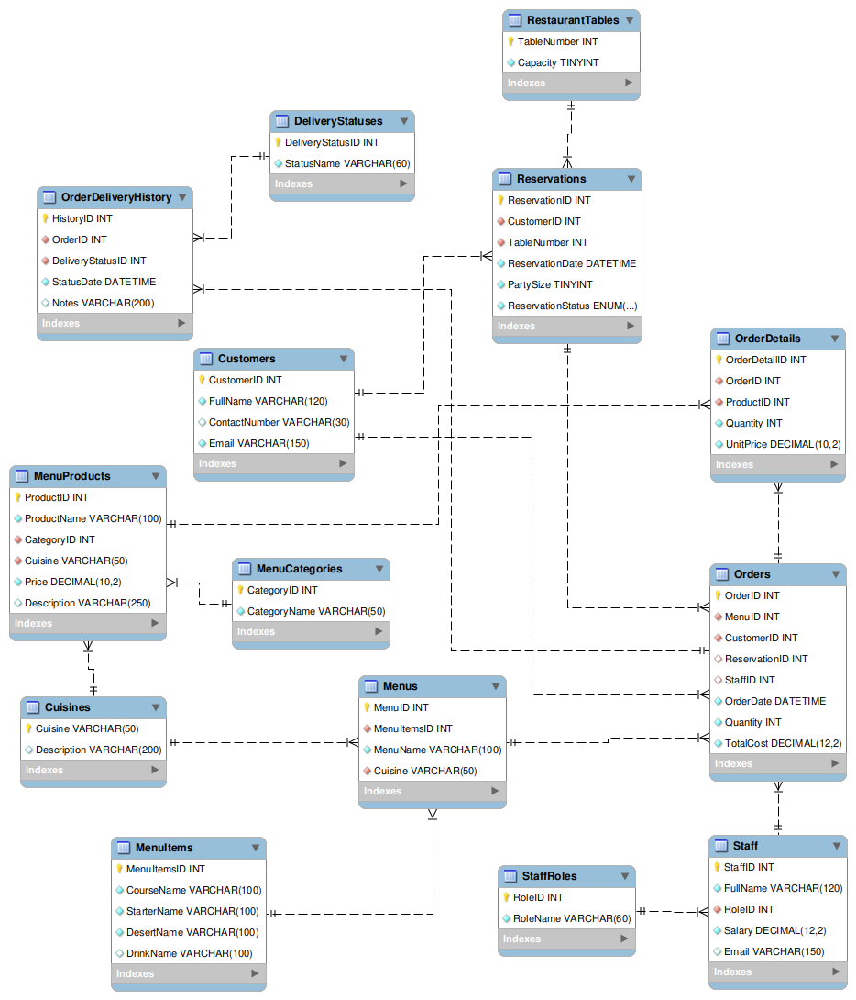

# Little Lemon: from database capstone to ELT pipeline

This repo started as my database engineering capstone: a MySQL 8.4
operational database for **Little Lemon**, a fictional restaurant that takes
orders, deliveries and table bookings.

I am turning it, in small increments, into a data engineering portfolio
project: **MySQL (OLTP) → PostgreSQL (raw / staging / marts) with dbt,
orchestrated by Airflow**.

> **Current status:** only the MySQL capstone exists today. The pipeline is
> planned, not built yet. Progress is tracked in [docs/ROADMAP.md](docs/ROADMAP.md).

## Data model

The database is `little_lemon_restaurante` and has 14 tables:

| Domain | Tables |
|---|---|
| Customers & orders | `Customers`, `Orders`, `OrderDetails`, `OrderDeliveryHistory`, `DeliveryStatuses` |
| Bookings | `Reservations`, `RestaurantTables` |
| Menu | `Menus`, `MenuItems`, `MenuProducts`, `MenuCategories`, `Cuisines` |
| Staff | `Staff`, `StaffRoles` |

It also includes triggers that keep `Orders.Quantity` and `Orders.TotalCost`
in sync with `OrderDetails`, and stored procedures for bookings and orders
(`AddBooking`, `CheckBooking`, `UpdateBooking`, `CancelBooking`,
`ManageBooking`, `CancelOrder`, `GetMaxQuantity`).



### Changes since the capstone

The capstone dumps are kept untouched as version 0. Schema changes are
applied on top of them as numbered migrations in `database/migrations/`:

- **001:** every table gets an `UpdatedAt` column that MySQL updates on each
  change (indexed on the 5 transactional tables), so the pipeline can extract
  only what changed. Cancelling no longer deletes rows: `CancelBooking` sets
  the booking to `'Cancelada'`, and `CancelOrder` adds a `'Cancelado'` event
  to `OrderDeliveryHistory`. See
  [ADR-002](docs/adr/002-cancel-by-status-instead-of-delete.md).

## Repository layout

```
database/
  schema/            Capstone schema dump (v0): tables, triggers and procedures
  sample-data/       Capstone data dump (INSERTs only)
  procedures/        Capstone stored procedures (v0, also in the schema dump)
  migrations/        Numbered schema changes applied after the dumps
scripts/
  explore_database.py  Python example: connects to MySQL and runs a few queries
  verify_load.py     Checks row counts and order totals after loading
  generate_synthetic_data.py  Adds ~4.4 M reproducible synthetic rows
  script1-4.sql      Capstone exercises: views, procedures, prepared statements
data/                Original course data (.xlsx)
models/              MySQL Workbench model (.mwb)
tableau/             Tableau workbook (.twbx)
screenshots/         ER diagram
docker/              Container setup (MySQL init scripts)
docs/                Roadmap and architecture decisions (adr/)
docker-compose.yml   Local MySQL 8.4 loaded with schema and data
```

## Running it locally

**Requirements:** Docker with Compose, and Python 3.

1. Configure the connection. Copy the template and fill in your own user and
   passwords. `.env` is git-ignored.

   ```bash
   cp .env.example .env
   ```

2. Start MySQL. On the first start it loads the capstone dumps
   (`docker/mysql/initdb/01-load-capstone-dump.sh`) and then applies the
   migrations (`02-apply-migrations.sh`). It is ready when the container
   shows as `healthy`:

   ```bash
   docker compose up -d --wait
   ```

   MySQL listens on `127.0.0.1:3307` (not 3306, so it does not clash with a
   local MySQL). The loader strips the `DEFINER=jeremias@localhost` clauses
   from the schema dump, so triggers and procedures belong to the user that
   creates them.

   The load only runs when the data volume is empty. To reload from scratch
   (for example after changing the dumps or adding a migration), delete the
   volume:

   ```bash
   docker compose down -v
   ```

3. Install the driver and run the example script:

   ```bash
   python3 -m venv .venv
   .venv/bin/pip install mysql-connector-python
   set -a; source .env; set +a
   .venv/bin/python scripts/explore_database.py
   ```

   If a variable is missing, the script exits with a message listing it.

4. Verify the load. The script checks the row count of all 14 tables and
   that every order's `Quantity` and `TotalCost` match its `OrderDetails`.
   It prints `OK`/`FAIL` per check and exits with code 0 only if all pass:

   ```bash
   .venv/bin/python scripts/verify_load.py
   ```

   The expected counts are those of the sample data right after loading
   (100 customers, 240 orders, 680 order lines, …). Calling `CancelOrder`
   adds a history row, so run it on a fresh load.

5. Optional: generate synthetic data. On a fresh load, this adds customers,
   bookings and orders from 2024-01-01 to 2026-07-31. The same `--seed` and
   `--scale` always produce exactly the same rows
   ([ADR-003](docs/adr/003-synthetic-data-generator.md)):

   ```bash
   .venv/bin/python scripts/generate_synthetic_data.py --seed 42 --scale 1.0
   .venv/bin/python scripts/verify_load.py --expected generated/expected_counts.json
   ```

   With `--scale 1.0` it inserts about 4.4 M rows (50 k customers, 56 k
   bookings, 501 k orders, 1.4 M order lines, 2.3 M status events) in about
   3 minutes, using about 1.3 GB of Docker volume. Use `--scale 0.01` for a
   quick run. The generator refuses to run twice on the same database; to
   start over, recreate it with `docker compose down -v`.

## Known limitations

- `scripts/script1.sql` and `scripts/script2.sql` use `USE LittleLemonDM`,
  but the database is now called `little_lemon_restaurante`, so they fail as
  they are.
- There is no `requirements.txt` yet.
- The data contains personal-looking fields (customer emails and phone
  numbers, staff salaries). It comes from the course dataset.
- More capstone issues that the pipeline work will fix are listed in
  [docs/ROADMAP.md](docs/ROADMAP.md#problemas-conocidos-del-capstone).
